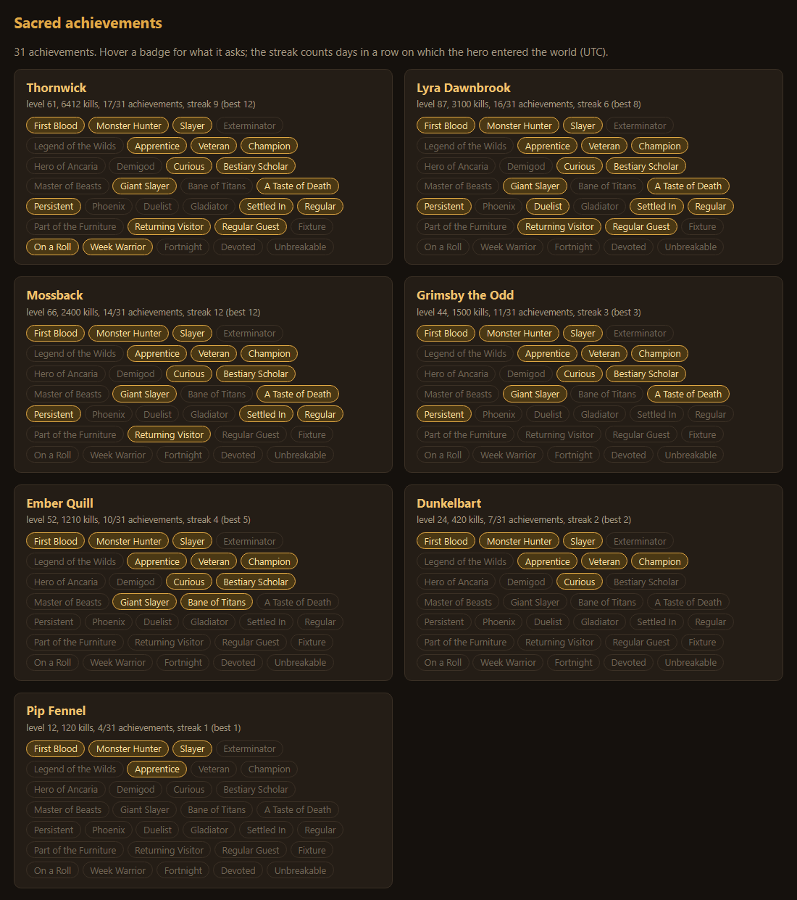

# Achievements and daily login streak (`achievements.lua`)

Achievements that unlock from what the server really sees, and a daily login streak that pays a growing reward. Everything is
kept on the server (`script-data/achievements.json`, per hero plus a roster for the web page).

*Demo data: fictional heroes, made-up progress. A highlighted badge is unlocked, a dim one is not; hovering a badge shows what it asks.*

## Install

Copy `Sacred.GameServer/scripts-examples/achievements.lua` into the server's scripts folder. Item rewards need `--game-dir`;
without it the gold of an item reward is paid instead (1000 gold, the `fallback` of the reward).

## What unlocks

31 achievements in the list `defs` at the top of the file (name, description, counter, target, reward, optional `shout`):

| Counter | Source | Examples |
|---|---|---|
| `kills` | creatures defeated | First Blood (1), Monster Hunter (100), Slayer (1,000), Exterminator (5,000), Legend of the Wilds (20,000) |
| `level` | hero level | Apprentice (10), Veteran (25), Champion (50), Hero of Ancaria (100), Demigod (150) |
| `species` | distinct creature types defeated | Curious (10), Bestiary Scholar (50), Master of Beasts (150) |
| `giants` | creatures 10 or more levels above the hero | Giant Slayer (1), Bane of Titans (25) |
| `deaths` | hero deaths | A Taste of Death (1), Persistent (10), Phoenix (50) |
| `pvp` | other players' heroes defeated | Duelist (1), Gladiator (10) |
| `online` | time on this server | Settled In (1 h), Regular (10 h), Part of the Furniture (100 h) |
| `days` | different days visited | Returning Visitor (3), Regular Guest (14), Fixture (60) |
| `best` | best login streak | On a Roll (3), Week Warrior (7), Fortnight (14), Devoted (30), Unbreakable (100) |

Each can pay `reward = { gold = n, item = quality }` (an item quality 0..14). `shout = true` tells everybody in chat
(`<hero> earned the achievement "<name>"!`). The unlocking hero gets a chat line with the reward.

**Login streak.** The first time a hero is in the world on a new UTC day it gets "Daily login: day N of your streak" and a
reward of 100 gold per streak day up to 1000, plus an item every 7th day (quality grows with the streak, at most 14). A
missed day starts the streak over at 1. `UTC_OFFSET_HOURS` (default 0) shifts where the day changes.

Rewards are queued and dropped next to the hero once the hero is in the world (retried up to 8 times).

## Chat commands

| Command | What it does |
|---|---|
| `!ach` (or `!achievements`) | "Achievements: N of 31 unlocked", your three latest, and the next one with progress (`have/target`) |
| `!streak` | Your streak, the best, days visited, and today's (or tomorrow's) reward |

## Settings (the `config` data of the mod)

The tables at the top of the script are the defaults of the first run; the live values are the storage key `config`, edited with
`POST /api/mod-store` and shown on `/mods/achievements/config` (see [README](README.md#configuration-live-edits-and-hot-reload)).
A reload keeps the roster, every hero's progress and the queue of rewards that could not be dropped yet (retried every 20 s while
the hero is in the world).

| Field | Default | Meaning |
|---|---|---|
| `utc_offset_hours` | 0 | Shifts the day change of the streak (-14 to 14) |
| `roster_limit` | 500 | Heroes shown on the page and kept in its roster (the ones seen longest ago are dropped) |
| `streak_gold_per_day`, `streak_gold_max_days` | 100, 10 | Login reward: gold per streak day, up to this many days |
| `streak_item_every`, `streak_item_quality`, `streak_item_max_quality` | 7, 4, 14 | Every n-th streak day also an item of quality base + streak / n, at most the maximum (0 = never an item) |
| `reward_tries` | 8 | A reward that cannot be dropped is retried this often, then given up |
| `item_fallback_gold` | 1000 | Gold given instead of an item when the server cannot drop items (no `--game-dir`) |
| `achievements` | 31 entries | The list: `id`, `name`, `desc`, `stat` (`kills level species giants deaths pvp online days best`), `target`, optional `reward` `{ gold, item }` and `shout`. An invalid entry is dropped; the ids are what heroes have unlocked, so keep them |

## Web page and endpoints

| Address | What |
|---|---|
| `/mods/achievements/` | One card per hero: level, kills, achievements `n/31`, streak (and best), and a badge for every achievement; sorted by the number unlocked; refreshes every 60 s |
| `/mods/achievements/players` | JSON: character, level, kills, streak, best_streak, days, count, unlocked ids |
| `/mods/achievements/achievements` | JSON: the list of achievements (id, name, description, reward) |

Also under `/public/mods/achievements/` with `WebUi:PublicApi=true`. Character names only.

## Gear client

The Gear mod `achievements` (client repository `gear/examples/achievements`) gets a toast for every unlock and for the daily
reward, and a panel, over the net channel `achievements:sync` (server only). The server pushes
`{ op = "unlock", id, name, desc, reward }`, `{ op = "streak", streak, best, reward }` and
`{ op = "state", ach = {{ id, name, desc, have, need, done, reward }, ...}, streak, best, days, claimed, next }`; the client asks
with `{ op = "get" }`. Without a Gear client or custom net messages the mod works through chat lines alone.

## Limits

Not covered, because the script API has no event or data for it: gold earned or held, exploration (the explored map is
client-only), quests, items found. Level has no event either: it is read from the player when kills, joins and a 20 s timer
come by. Unverified with a real client: that the owner can pick up what `drop_gold` / `drop_item` drops.
