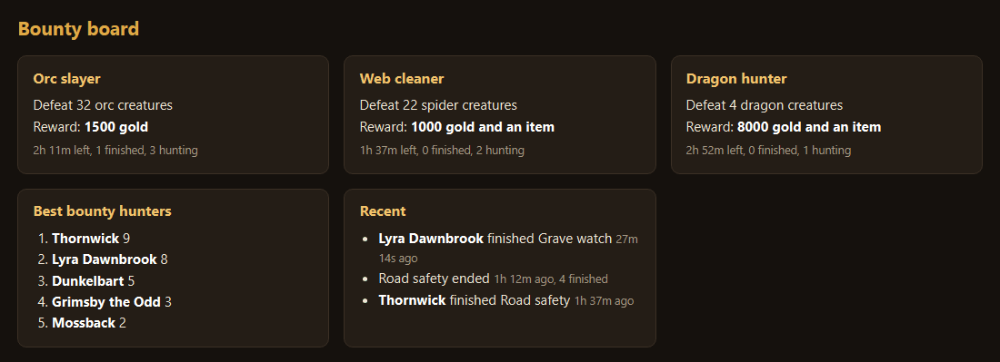

# Bounty board (`bounty_board.lua`)

The server posts a few bounties at a time ("kill 25 orcs", optionally only in some sectors). Every hero works on them on their
own; finishing one pays gold and/or an item, once per hero. Bounties run for a while, expire and are replaced from a pool, so
the board rotates by itself.



*Demo data: fictional heroes, made-up progress.*

## Install

Copy `Sacred.GameServer/scripts-examples/bounty_board.lua` into the server's scripts folder (default `./scripts`). It starts
posting at once (three bounties) and reloads when the file changes. Everything it keeps (the board, each hero's progress, the
last completions) is in `script-data/bounty_board.json`.

Needs `--game-dir` for the `names` filters and for item rewards (without it a creature has no name; use `types` in the pool).
`sectors` needs `player.sector`. Gold is dropped as a pile next to the hero, items with `server.drop_item`.

## Chat commands

| Command | What it does |
|---|---|
| `!bounty` (or `!bounties`) | Lists the open bounties with your progress (`n/target` or `done`), the time left and the reward; sent to you only |
| `!where` | Tells the number of the sector you stand in, for the `sectors` lists of the pool |

New bounties, completions and expiries are announced to everybody (`announce`), and a hero entering the world is told how many
bounties are open.

## Settings (the `config` data of the mod)

The tables at the top of the script are the defaults of the first run; the live values are the storage key `config`, edited with
`POST /api/mod-store` and shown on `/mods/bounty_board/config` (see [README](README.md#configuration-live-edits-and-hot-reload)).
A reload keeps the board and everybody's progress.

Fields:

| Key | Default | Meaning |
|---|---|---|
| `slots` | 3 | Bounties on the board at the same time |
| `duration` | 3 h | Default lifetime of a bounty (a pool entry may set its own `duration`, seconds) |
| `announce` | true | Broadcast new bounties and completions |
| `history` | 10 | Completions and expiries kept for the dashboard |
| `max_hunters` | 5000 | Heroes remembered per bounty (more can play, their progress is just not kept) |

`pool` (a list; the bounties it draws from, never the same entry twice at once; at least one entry must be valid):

| Field | Meaning |
|---|---|
| `id`, `title` | Short key and the name shown to players |
| `names` | Only creatures whose name contains one of these words count (any case; needs `--game-dir`) |
| `types` | Or creature type numbers, when the server has no game data |
| `sectors`, `region` | Only kills in these sector numbers count (find them with `!where`); `region` is the name shown |
| `target` | A number, or `{ min, max }` drawn when the bounty is posted |
| `min_level` | Heroes below this level do not count (default 1) |
| `duration` | Lifetime in seconds |
| `reward` | `gold = n` for each hero who finishes, `item = { quality = .., category = .. }` as for `server.drop_item` |

The default pool has orcs, undead, spiders, brigands and dragons (level 20+); a commented example shows a one-region bounty.
A bounty is a snapshot of its pool entry: editing the pool does not change bounties already posted. An entry needs an `id`, `names`
or `types`, and a `target`; entries that miss one are left out and listed on the overview page.

## Web page and endpoints

| Address | What |
|---|---|
| `/mods/bounty_board/` | The dashboard: open bounties (text, reward, time left, finished and hunting counts), the best bounty hunters, recent completions and expiries; refreshes every 30 s |
| `/mods/bounty_board/state` | The same as JSON: `bounties`, `recent`, `top` |

Both are also under `/public/mods/bounty_board/` with `WebUi:PublicApi=true`. Character names only.

## Gear client

The Gear mod `bounty` (client repository, `gear/examples/bounty`) shows the board in a panel and a small tracker, over the net
channel `bounty:state` (`server_only`). The client may send anything (for example `{ req = 1 }`) to ask for its state; the
server answers with, and pushes on every change of the board or of that hero's progress:

```
{ v = 1, next_in = seconds, bounties = { { id, title, text, region, target, n, done, left, reward, claims, level }, ... } }
```

`n` is the hero's own progress; `left` is the seconds until the bounty expires (relative, so clocks need not agree). See the
client's documentation for the panel.

## Limits

* Only kills the server sees count (the `kill` event). A creature must have a name matching `names`, or a type in `types`.
* Rewards are dropped next to the hero: unverified with a real client that the owner can pick them up.
* The reward is dropped the moment a hero reaches the target. A bounty that expires first pays nothing; progress is kept
  per hero for that bounty only.
