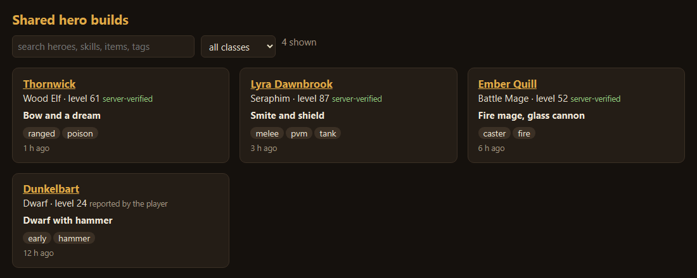
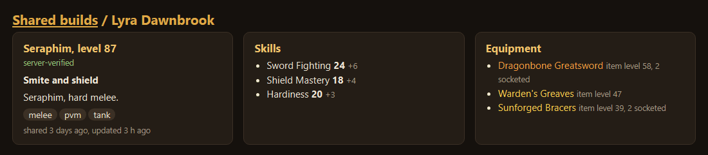

# Build sharer (`build_sharer.lua`)

Players publish their hero build (class, level, skills, equipment) to the server. Everybody can browse and search the shared
builds on a web page, and Sacred Gear clients can list and fetch them in a panel.

*Demo data: fictional heroes and builds. "server-verified" builds were filled from the server's own view of the hero; "reported by the player" ones only have class and level.*

One build in full (`?id=b1`):

The card list has a live text filter and a class filter (done in the page with a small inline script); `?q=orc&class=3` also
filters on the server. The detail page shows the class, level, verified badge, title, note and tags, then cards for skills
(with level and bonus), combat arts, equipment (coloured by item tier, with item level and sockets) and, for builds without
hero data, the carried items the player reported.

## Install

Copy `Sacred.GameServer/scripts-examples/build_sharer.lua` into the server's scripts folder. Builds live in this mod's storage
(`script-data/build_sharer.json`, one value `build:<id>` per build).

For "server-verified" builds the server needs hero data (`server.hero`): the web UI running, or `--authoritative`. Skill and
item names need `--game-dir`.

## Where the data comes from

* With `server.hero` the **server** fills class, level, skills, combat arts and equipment from its own copy of the hero: a
  client cannot make those up (shown "server-verified").
* Without hero data the build has only class and level as the server knows them, plus what the client says about itself: a
  title, a note, tags and the items it carries (shown "reported by the player"). Gear cannot read a hero's skills or worn
  equipment, so a client could not send them anyway.
* Whatever a client sends is length limited, type checked and HTML-escaped when shown.

## Chat commands

| Command | What it does |
|---|---|
| `!sharebuild [title]` | Publishes (or updates) your build with the title |
| `!unsharebuild` | Removes your build |
| `!builds` | Says how many builds are shared |

## Settings (the `config` data of the mod)

Defaults at the top of the script seed the storage key `config` on the first run; edit it with `POST /api/mod-store`, see it on
`/mods/build_sharer/config` ([README](README.md#configuration-live-edits-and-hot-reload)). Builds are stored as they are published;
a reload also keeps the publish cooldowns and the request budgets (rate limits), so reloading is no way round them. Caps cut what
a client sends from then on; builds already stored are cut to the caps when the mod loads.

| Field | Default | Meaning |
|---|---|---|
| `max_builds` | 200 | Builds kept, one per hero; more are refused until somebody removes theirs |
| `max_title`, `max_note`, `max_tag`, `max_tags`, `max_carried`, `max_item` | 40, 240, 16, 5, 12, 48 | Length and count limits of what a client sends |
| `max_skills`, `max_arts`, `max_equipment` | 8, 40, 19 | List sizes stored |
| `max_query`, `max_page_size`, `default_page_size` | 40, 25, 12 | Search text and page limits |
| `publish_cooldown` | 15 s | Between two publishes of one hero (the earlier storage key `publish_cooldown` is the default) |
| `bucket_capacity`, `bucket_refill` | 8, 0.5/s | Request budget of a client: a burst of 8, then one every 2 s |

| `CLASS_NAMES` (script, not data) | Seraphim 1, Gladiator 2, Battle Mage 3, Dark Elf 4, Wood Elf 5, Vampiress 6, Dwarf 8, Daemon 9 | Hero type numbers of Sacred Gear; the class byte of the server is passed as is (unverified against a real client) |

## Web page and endpoints

| Address | What |
|---|---|
| `/mods/build_sharer/` | Every build as a card (name, class, level, verified badge, title, tags, age), with a live filter; `?q=&class=` filters on the server too |
| `/mods/build_sharer/?id=b3` | One build in full |
| `/mods/build_sharer/builds?q=&class=&sort=new\|level&page=1&n=12` | JSON list (`class` as number or name, `n` at most 25) |
| `/mods/build_sharer/build?id=b3` | JSON, one build (404 `no such build` otherwise) |

Also under `/public/mods/build_sharer/` with `WebUi:PublicApi=true`. Character names only: no account, no ids.

## Gear client

The Gear mod `buildsharer` uses the channel `buildsharer`. Requests: `list { q, class, sort, page, per }`, `get { id }`, `mine`,
`publish { title, note, tags, carried, level }`, `unpublish`. Answers: `list`, `build`, `mine`, `published`, `unpublished`,
`error`. Every request is checked on the server (types, lengths, the budget above).

## Limits

Not done: moderation (the owner edits the storage file), ratings, comments, importing a build into a hero (a build is a
description, not a save). The class numbers of the FIRSTCONTACT byte have not been checked against a real client.
