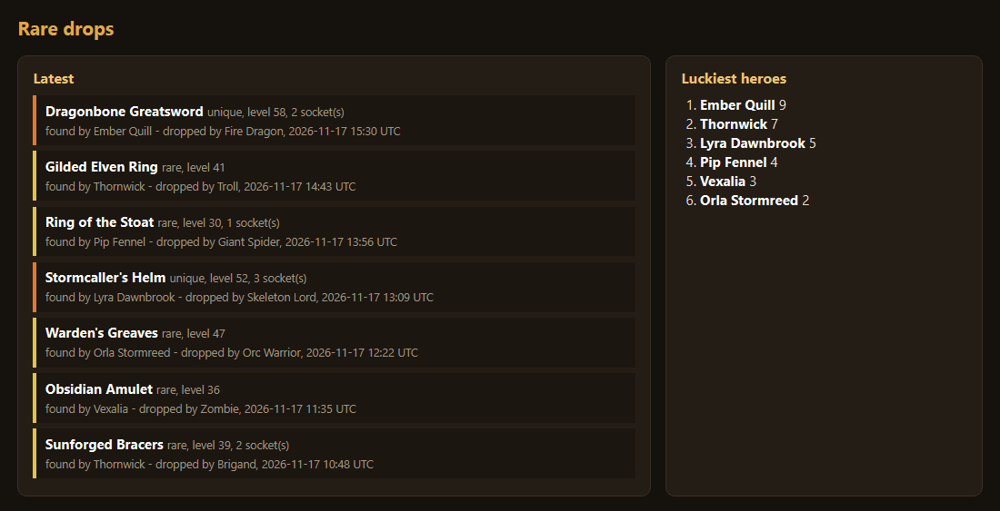
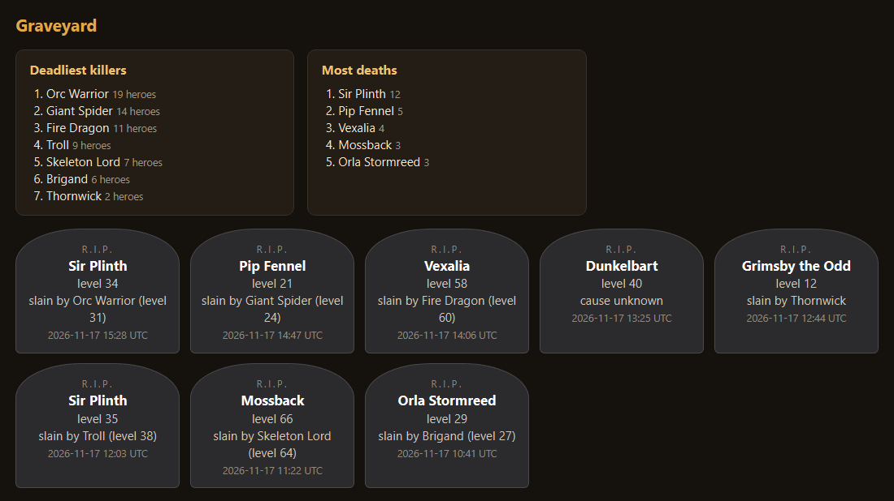

# Live feeds: rare drops and graveyard

Two mods that watch what happens in the world and publish it as a web page, JSON/CSV, a chat line and a message to Sacred Gear
clients (the client mod `serverfeed` shows them on screen).

Install either one by copying its `.lua` file from `Sacred.GameServer/scripts-examples/` into the server's scripts folder.
Storage: `script-data/rare_drops.json` and `script-data/graveyard.json`. Names of items and creatures need `--game-dir`.

## Rare drops (`rare_drops.lua`)

A live feed of rare and unique items that appear on the ground, with the creature that dropped them and the hero who defeated it,
plus a "Luckiest heroes" ladder.

*Demo data: invented drops, fictional heroes. The coloured bar at the left of each entry is the tier (unique orange, rare yellow, magic blue).*

**How a drop is detected.** The script API has no "item dropped" event of its own, so the server got one:
`server.on("drop", function(item, reporter) ... end)`, fired when a new item object lies on the ground
(`item = { ref, type, level, rarity, sockets, price, name, sector, x, y }`). The game sends no message that says who dropped it:
the item is reported by the client that owns the sector. The mod therefore ties a drop to the creature defeated in the last
`kill_window` seconds (the most recent one) and, while `require_kill` is on, ignores items without a kill (chests, items already
lying around when a client enters a sector). Rarity is the item's tier 0..15 as Sacred Gear shows it: 0-4 normal, 5-11 magic,
12-14 rare, 15 unique.

Settings: the `config` data of the mod (edit with `POST /api/mod-store`, overview on `/mods/rare_drops/config`, see the
[README](README.md#configuration-live-edits-and-hot-reload)). A reload keeps the feed.

| Field | Default | Meaning |
|---|---|---|
| `min_rarity` | 12 | Announce items of this tier and above (12 rare and unique, 15 only unique) |
| `require_kill` | true | Only drops that follow a kill within `kill_window` seconds |
| `kill_window` | 5 | Seconds |
| `announce` | true | Chat line to everybody ("<hero> found a rare <item>, dropped by <creature>!") |
| `keep` | 100 | Drops kept |

| Address | What |
|---|---|
| `/mods/rare_drops/` | The feed (latest 40) and "Luckiest heroes" (per-hero counter `rare`); refreshes every 15 s |
| `/mods/rare_drops/feed?n=20` | JSON: time, item, tier, rarity, level, sockets, hero, creature |
| `/mods/rare_drops/feed.csv` | The same as CSV |

Gear channel `rare_drops:feed` (server only): pushes `{ kind = "drop", drop = { item, tier, rarity, by, from, time } }` to all, and
answers any message with `{ kind = "recent", drops = {...} }` (the latest five).

## Graveyard (`graveyard.lua`)

Recent hero deaths with the name of the killer (creature or hero), the deadliest creatures and the heroes who died most.

*Demo data: fictional heroes and deaths. "cause unknown" is what the page shows when the server could not tell the killer.*

Killer names are the game's own texts, so the server needs `--game-dir` for them (otherwise "creature type N"). A hero death is
reported once (several reports within 2 s count once).

Settings: the `config` data of the mod (edit with `POST /api/mod-store`, overview on `/mods/graveyard/config`, see the
[README](README.md#configuration-live-edits-and-hot-reload)). A reload keeps the deaths and the killers' counts.

| Field | Default | Meaning |
|---|---|---|
| `keep` | 200 | Deaths kept |
| `announce` | true | "<hero> was slain by <killer>." to everybody |
| `page_stones` | 48 | Tombstones on the page |
| `page_killers` | 8 | Rows of "Deadliest killers" on the page |

| Chat | What |
|---|---|
| `!rip` | The last three deaths, sent to the player who asked |

| Address | What |
|---|---|
| `/mods/graveyard/` | Tombstones, deadliest killers, most deaths; refreshes every 30 s |
| `/mods/graveyard/recent?n=20` | JSON: time, hero, level, killer, killer_kind, killer_level |
| `/mods/graveyard/recent.csv` | The same as CSV |
| `/mods/graveyard/deadliest` | JSON: killer and how many heroes it killed |

Gear channel `graveyard:feed` (server only): pushes `{ kind = "death", name, level, by, killer_kind, time }` to all and answers any
message with `{ kind = "recent", deaths = {...} }` (the latest five).

## Both

All endpoints are also under `/public/mods/<mod>/` with `WebUi:PublicApi=true`. Only character names are shown. The Gear mod
`serverfeed` listens on both channels, shows each live message as a coloured line for a few seconds and keeps a list of the
latest twelve; a server without these scripts never sends on the channels, so that client mod stays idle.
