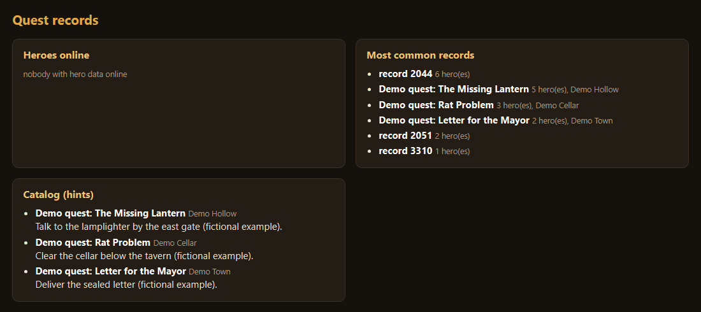

# Quest helper (`quest_helper.lua`)

Shows a hero's quest records with the hints and places this server's owner wrote for them, tells a player when a record is new
or changed, and shows which other heroes have the same record.

*Demo data: invented record keys and fictional "Demo quest" catalog entries. "Heroes online" is empty because nobody was
connected; it lists online heroes that have hero data.*

## Read this first: what the server really knows

A hero file carries exactly one kind of quest state: the **quest pairs**, 8-byte `[key][value]` records of the inventory stream
that the game appends when a scripted event or a quest item changes something (Sacred.exe `0x5D8280`; see the server README,
"Quest pairs"). `server.hero(player).quest_pairs` gives them.

The journal (active quests, their text, the map markers) and the script variables of the quests are world state of the game's
interpreter. They are not in a hero file and no message carries them, so this server **cannot list "active quests", "available
quests" or progress percentages**, and nobody has mapped which key belongs to which quest. So the mod is a catalog framework:

* every record the hero has is listed (key and value); new and changed records are announced;
* a key that is in the **catalog** gets a name, an area, a hint and value labels;
* every other key is shown as `record <key>`. Fill the catalog as you learn what a key means.

It needs hero data on the server (the web UI or `--authoritative`); without it the mod says so and shows nothing made up.

## Install

Copy `Sacred.GameServer/scripts-examples/quest_helper.lua` into the server's scripts folder. Storage:
`script-data/quest_helper.json` (the keys seen, each hero's value per record, and the optional `catalog`).

## The catalog

The `catalog` field of the mod's `config` (empty on purpose: nothing is guessed): a JSON object keyed by the record key as a
string. Example, not a real quest:
`"catalog": { "1234": { "name": "Example quest", "area": "Somewhere", "hint": "Talk to X.", "states": { "1": "started", "2": "done" } } }`.
Write it with `POST /api/mod-store` (it applies within 2 seconds, no reload). The storage key `catalog` of earlier versions is still
read and merged (the config entry wins). Entries whose key is not a number are left out and listed on the overview page.

Texts are shortened (name and area 60, hint 400, value labels 60 characters) because players see them.

## Chat commands

| Command | What it does |
|---|---|
| `!quests` | Says how many records you have, then your five newest with name, value, value label and area; says "no hero data" if the server has none |

A new or changed record also gives a chat line ("Quest record: <name>", with the hint), at most one per hero in 3 s.

## Settings (the `config` data of the mod)

Defaults at the top of the script seed the storage key `config` on the first run; edit it with `POST /api/mod-store`, see it on
`/mods/quest_helper/config` ([README](README.md#configuration-live-edits-and-hot-reload)). A reload keeps the records the server
knows and, for heroes who are online, the baseline of their records, the panels that are watching and the request budgets, so a
change right after a reload is still announced.

| Field | Default | Meaning |
|---|---|---|
| `catalog` | empty | See "The catalog" |
| `poll_seconds` | 5 | How often online heroes in the world are read for changes (applies on the next reload) |
| `max_pairs` | 120 | Records sent to a client at once |
| `max_others` | 6 | Other heroes named per record |
| `max_known_keys` | 400 | Records the server remembers (the page lists 50) |
| `notice_seconds` | 3 | At most one chat notice per hero in this time |
| `bucket_capacity`, `bucket_refill` | 6, 0.5/s | Request budget of a client |

## Web page and endpoints

| Address | What |
|---|---|
| `/mods/quest_helper/` | Three cards: heroes online with their record counts, the most common records (name or `record <key>`, hero count, area), and the catalog with hints; refreshes every 30 s |
| `/mods/quest_helper/records` | JSON: every record the server has seen (top 50), its catalog name, area and hint, and how many heroes have it |

Also under `/public/mods/quest_helper/` with `WebUi:PublicApi=true`. Character names only.

## Gear client

The Gear mod `questhelper` uses the channel `questhelper`. Requests: `state { watch }`, `unwatch`; answers `state`, `error`. With
`watch = true` the server pushes the state again when a record changes. A state is either `{ op = "state", available = false,
reason }` or `{ op = "state", available = true, total, known, records = {{ key, value, name, area, hint, label, known, others,
changed }}, catalog, time }`.

## Limits

* No quest journal, no list of active or available quests, no progress, no key-to-quest mapping (see above).
* Changes are noticed by polling every 5 s, so a record that changes and changes back in between is missed.
* In the five hero saves the author had, the quest-pair list was empty; whether real play fills it has not been verified.
