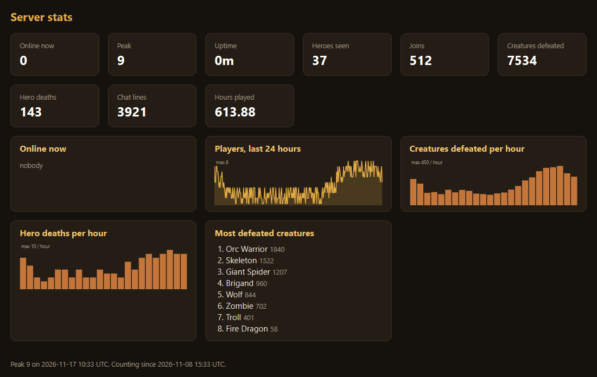
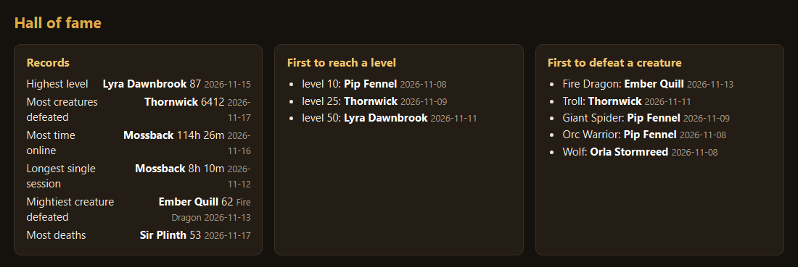
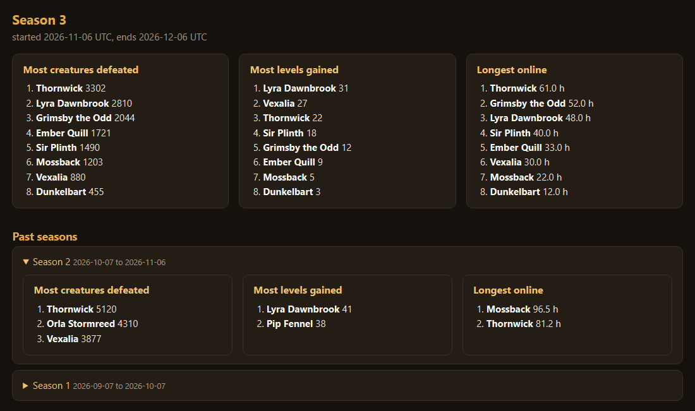

# Statistics mods: server stats, hall of fame, seasons, ladders

Four mods with their own storage and a public page each. None needs a game directory or a Gear client, and none
talks to the client. Copy the `.lua` file from `Sacred.GameServer/scripts-examples/` into the server's scripts folder to use it.
All endpoints are also under `/public/mods/<mod>/` with `WebUi:PublicApi=true`. Only character names are shown.

## Server stats (`server_stats.lua`)

Who is online, the peak, uptime, totals (joins, heroes, kills, deaths, chat lines, hours played), the last 24 hours of players and
activity, and the most defeated creatures. Storage: `script-data/server_stats.json`.

*Demo data: invented numbers and curves. "Online now 0" and "Uptime 0m" are real (the server had just started and nobody was
connected). "Uptime" counts from the start of the mod and survives a hot reload (the start time is stored); a restart begins anew.*

Settings: the `config` data of the mod (defaults at the top of the script seed it; edit with `POST /api/mod-store`, overview on
`/mods/server_stats/config`, see the [README](README.md#configuration-live-edits-and-hot-reload)). A reload saves the samples,
hourly buckets, creature counts and the peak at once.

| Field | Default | Meaning |
|---|---|---|
| `sample_seconds` | 300 | One players-online sample every 5 minutes (applies on the next reload) |
| `keep_samples` | 288 | ... for 24 hours |
| `keep_hours` | 48 | Hourly activity buckets kept (24 h are shown) |
| `top_creatures` | 8 | Rows of "Most defeated creatures" |

| Address | What |
|---|---|
| `/mods/server_stats/` | Server-rendered dashboard, refreshes every 30 s, charts are inline SVG (no script): tiles for online now, peak, uptime, heroes seen, joins, creatures defeated, hero deaths, chat lines, hours played; online list; players over 24 h; creatures defeated and hero deaths per hour; most defeated creatures |
| `/mods/server_stats/stats` | The same numbers as JSON |

## Hall of fame (`hall_of_fame.lua`)

All-time records (highest level, most creatures defeated, most deaths, longest single session, most time online, mightiest
creature defeated), the first hero to reach each level milestone and the first hero to defeat each kind of creature.
Storage: `script-data/hall_of_fame.json`.

*Demo data: fictional heroes and records.*

Records beaten by another hero are announced to everybody, but only above the minimums below, so a fresh server does not shout.
A tie keeps the old holder. Level milestones are announced as "the first hero on this server to reach level N".

Settings: the `config` data of the mod (edit with `POST /api/mod-store`, overview on `/mods/hall_of_fame/config`, see the
[README](README.md#configuration-live-edits-and-hot-reload)). A reload keeps all records and lists.

| Field | Default | Meaning |
|---|---|---|
| `milestones` | 10, 25, 50, 100, 150, 200 | Levels announced as "first hero to reach" |
| `announce_min` | level 30, kills 500, deaths 50, biggest 40 | Records below these are kept, not announced |
| `keep_first_kills` | 60 | First-kill entries kept (the page shows 20) |
| `announce` | true | Broadcast records and "first to reach" messages at all |

| Address / chat | What |
|---|---|
| `/mods/hall_of_fame/` | The page: records, first to reach a level, first to defeat a creature; refreshes every 60 s |
| `/mods/hall_of_fame/records` | JSON: the records |
| `/mods/hall_of_fame/firsts` | JSON: level milestones and first kills of each creature |
| `!hof` | The records to the player who asked |

## Seasons (`seasons.lua`)

Seasonal ladders on the pattern of `ladders.lua`: the same kinds of boards (creatures defeated, levels gained, time online) but
per season. When a season ends (after `length_days`, or by hand) its top heroes are archived and a fresh season starts from zero.
Storage: `script-data/seasons.json`; per-hero numbers live under keys such as `s3.kills`, old seasons' keys stay in the file (small).

*Demo data: fictional heroes, invented seasons. The newest past season is shown expanded; on the live page the archive entries
start collapsed and open with a click.*

Settings: the `config` data of the mod (edit with `POST /api/mod-store`, overview on `/mods/seasons/config`, see the
[README](README.md#configuration-live-edits-and-hot-reload)). A reload does not touch the season: its number, start and the archive
are stored (the start is saved at the first run), so the boundary stays where it was; changing `length_days` moves the end of the
season that is running.

| Field | Default | Meaning |
|---|---|---|
| `length_days` | 30 | `0`: a season ends only by hand |
| `keep_archive` | 24 | Past seasons kept |
| `top_n` | 10 | Rows per board |
| `announce` | true | Tell everybody when a season ends |
| `boards` | kills, gain, online | A list of `{ id, title, scale, unit }`; `id` is `kills` (creatures defeated), `gain` (levels gained: best level minus the level at the first sighting in the season) or `online` (seconds, shown divided by `scale`, hours by default); drop one from the list to hide it |

| Address / chat | What |
|---|---|
| `/mods/seasons/` | This season's standings, the start and end date, and the archive of past seasons; refreshes every 60 s |
| `/mods/seasons/current` | JSON: this season |
| `/mods/seasons/archive` | JSON: past seasons, newest first |
| `/mods/seasons/end-season` | **Admin only** (needs the web password, never public): ends the season now, archives it and starts the next; answers `{ ended, season }` |
| `!season` | Season number, time left and your place by creatures defeated |

When a season ends everybody is told the champion in chat.

## Ladders (`ladders.lua`)

The original example, kept for reference. A dashboard with cards for the top heroes, the best hunter per creature and recent
deaths, in its own storage (`script-data/ladders.json`). No screenshot (it is not one of the new mods).

| Address / chat | What |
|---|---|
| `/mods/ladders/` | The dashboard |
| `/mods/ladders/top?board=kills&n=10` | JSON rows of a ladder (kills, level, online) |
| `/mods/ladders/by-creature` | CSV: creature, best hunter, kills |
| `!top` | The kill ladder to the player who asked |

## Limits

Statistics only see what the script events give: kills, deaths, joins, chat, and the player's level at kills, joins and
timers (there is no level-up event). Hall of fame adds a hero's session time when the hero leaves, so an unclean server stop
can lose the time of the heroes who were connected.
