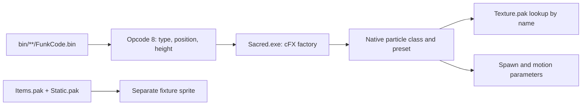

# Particle definitions in Sacred Gold

Latest decoding: [Dwarf Mine Sign through REA](mine-sign-fx.md) adds its native
count-scaled particle ring, radial rotation, carry stall rule and mine-use
retirement through the shared Viewer/world/Terminal CPU path. Four layouts map
saved/object/event fields and combat-art ratio/cap inputs. Coverage is
**148 recipes / 113 FX rows**: 34 script and 112 event recipes plus two portals.
**4,018,800 native comparisons**, **1,848 integration checks** and six
screenshot-cheat captures pass. Existing reader checks, shared playback checks,
fresh generation and Viewer/Terminal builds pass. Live combat inputs, audio,
native random-stream coupling and GPU simulation remain pending.

Previous decoding: [Blood Fountain through REA](blood-fountain-fx.md) adds all three
native palettes, local-X jet fade and floor-collision retirement through the
shared Viewer/world/Terminal CPU path. Three layouts map saved, object and event
bytes. Coverage is **147 recipes / 112 FX rows**: 34 script and 111 event recipes
plus two portals. **42,210 native comparisons**, **1,470 targeted integration
checks**, **380 Emperor checks** and **12 screenshot-cheat captures** pass.
Viewer/Terminal builds, fresh generation and Items.pak mapping pass. Live gameplay
orientation/attachment, audio, notifications and GPU simulation remain pending.

Previous decoding: [Emperor through REA](emperor-fx.md) adds its timed particle
emitter, conditional randomized flare and native hit extension/size controller.
Two layouts map the complete saved block and base/resource fields. Coverage is
**144 recipes / 111 FX rows**: 34 script and 108 event recipes plus two portals.
**2,277,732 native comparisons**, **380 targeted integration checks** and
**4,959,631 existing Plong/Stoned/Teleport checks** pass. Ten live screenshot-cheat
captures, Viewer/Terminal builds and fresh generation pass. REA's instruction and
byte inspection works; its Ghidra analysis did not recognize these FX functions
for decompilation. See the linked experiment notes for setup and coverage limits.

Previous decoding: [Plong and Stoned](plong-and-stoned-fx.md) adds two event
families: a forty-slot manual particle burst with gravity/bounce and a randomized
stone model resolved through Items.pak. Six layouts map saved state, particle
bytes, resources, owner notification and combat duration inputs. Coverage is
**143 recipes / 110 FX rows**: 34 script and 107 event recipes plus two portals.
**1,378,632 native comparisons** pass against 4,032 original updates/renders.
**Over 4.9 million targeted Viewer/world/Terminal and Teleport checks** pass; all 143
previews pass **35,221,590 geometry checks** across nine actors. Hidden console
validation produces **20 screenshot-cheat captures** with no missing textures.
Fresh catalogue/source verification and Viewer/Terminal builds pass. Plong uses
the shared world/Terminal particle path. Stoned owner texture buffs, live combat
inputs, moving attachment and world/Terminal model placement remain pending.

Previous decoding: [Door Spike](door-spike-fx.md) adds its complete six-model event
preview and native grow/hold/release/shrink controller. Four layouts map all ten
saved scales/offsets, the 0xB0-byte state, base controls and resource handles.
Coverage is **141 recipes / 108 FX rows**: 34 script and 105 event recipes plus
two portals. **96,138 native comparisons** pass against 648 original updates/renders
and 5,184 complete model/shadow submissions. **136,148 targeted Viewer checks**
and **21 screenshot-cheat captures** pass. The shared x87 evaluator now preserves
signed zero; all existing native reader checks, fresh catalogue comparisons,
generated-source verification and Viewer/Terminal builds pass. World/Terminal
model placement and scene shadows remain pending.

Rendering correction: grayscale RGBA textures now keep their authored RGB
brightness. The old classifier incorrectly selected an alpha-only mask and
turned both ground flares into solid diamonds. **16 channel regressions** pass;
**26 corrected captures** and **37 earlier-ring regression captures** were
checked through console cheats. See [corrected previews](expanding-burst-fx.md#grayscale-texture-correction).

Previous decoding: [Ring of Poison and Kamikaze](expanding-burst-fx.md) adds two
complete event previews: a 150-slot particle burst, fifty expanding ring strips
and two independently rotating ground flares. Four layouts map saved state,
resources and Kamikaze's unsigned event radius rate. Coverage is **140 recipes /
107 FX rows**: 34 script and 104 event recipes plus two portals. **860,619 native
comparisons** pass against 1,440 original updates/renders and 34,560 complete
surface submissions, including standard particle draw dispatch and movement.
Both previews pass **16,546 viewer/world checks**; all 140 recipes pass
**34,998,385 geometry checks** across nine actors. Hidden console validation
produces **26 screenshot-cheat captures** with no missing textures. Fresh reader,
generated-source checks and Viewer/Terminal builds pass. Particle output uses the
shared world/Terminal path; world ring/ground surfaces, scene commands, lights
and combat event integration remain pending.

Previous decoding: [Bubble Trap Explosion and Terror Sprinter](ring-surface-fx.md)
adds three event recipes across two constructors, including both Terror Sprinter
modes. Complete 50/20-segment rings preserve randomized rune resources, ground
glow, packed colors, blending and strict boundaries. Six layouts map saved blocks,
object resources and event inputs. Coverage is **138 recipes / 105 FX rows**:
34 script and 102 event recipes plus two portals. **984,001 comparisons** pass
against 1,728 original updates/full renders and 48,816 complete submissions.
The three recipes pass **8,744 targeted viewer checks**; hidden console validation
produces **37 captures** with no missing textures. Fresh catalogue comparisons,
generated-source verification and the Viewer build pass. Combat caller/owner buffs,
scene lights, moving attachment and world/Terminal surfaces remain pending.

Previous decoding: [War Cry Sign](war-cry-sign-fx.md) adds the complete swept-fin
event recipe, including its ground glow, all eighty sector tests, opposite fins
and repeated highlights. Three layouts map the saved controller, event duration,
resources and mutable vertices. Coverage is **135 recipes / 103 FX rows**:
34 script and 99 event recipes plus two portals. **2,161,938 comparisons** pass
against 648 original updates/full renders and 80,262 complete submissions.
All 135 previews pass **34,973,095 geometry checks** across nine actors; hidden
console validation produces **23 captures**. Full reader/fresh-executable checks,
generated-source verification and the Viewer build pass. Combat caller/notification
dispatch, moving attachment and world/Terminal surfaces remain pending.

Previous decoding: [Transdim, Pong Ball and Zhadum](pulse-flare-fx.md) add three event recipes
with complete native ground/billboard renderers: all fifteen randomized Transdim
planes, Pong Ball's conditional hit flares and persistent glow, and Zhadum's triggered
hold/fade. Six layouts map saved blocks, resource tails and base controls. Coverage
is **134 recipes / 102 FX rows**: 34 script and 98 event recipes plus two portals.
**148,099 comparisons** pass against 1,620 original updates/full renders and 9,954
plane submissions. All 134 previews pass **33,032,790 geometry checks** across nine
actors. Hidden console validation produces **77 captures**; reader/generated checks
and Viewer/Terminal builds pass. White surface tint also restores BFG's ground glow.
Scene commands, world/Terminal surfaces and Pong minigame integration remain pending.

Previous decoding: [Panzer and Stahl](column-flare-fx.md) add two event recipes with
complete 71-plane columns. Shared playback preserves strict grow/hold/fade phases,
rotation, stored slice heights, alpha falloff and native float light RGB. Three
layouts map saved state, event duration inputs and light/texture handles. Coverage
is **131 recipes / 99 FX rows**: 34 script and 95 event recipes plus two portals.
**720,093 comparisons** pass against 720 original updates/full renders and 51,120
complete plane submissions. All 131 previews pass **32,980,465 geometry checks**
across nine actors. Hidden console validation produces **48 captures**;
reader/generated checks and Viewer/Terminal builds pass. Standalone duration is
explicitly ten seconds; owner buffs, scene lights and world/Terminal surfaces
remain pending.

Previous decoding: [BFG and Trap02 Pill/Ghost](sprite-flare-fx.md) add three event recipes
across three separate constructors sharing the billboard-flare helper. BFG keeps
all three animated grayscale layers and its ground glow; both traps preserve the
native asymmetric size pulse, blend selection and Pill removal flag. Five layouts
map saved state, base control inputs and resource handles. Coverage is **129 recipes
/ 97 FX rows**: 34 script and 93 event recipes plus two portals. **99,797 comparisons**
pass against 2,430 original updates/full renders, including exact boundaries,
restored continuation and three camera bases. All 129 previews pass **32,707,699
geometry checks** across nine actors. Hidden console validation produces **45
captures**; reader/generated checks and Viewer/Terminal builds pass. Owner/audio/light
integration, Trap02 parent gameplay and world/Terminal surfaces remain pending.

Previous decoding: [Live Undead, Call of Death and Trap01](controlled-ground-flares.md) add three
complete event previews across three separate constructors sharing stdLensflare.
All four revival layers, fractional death-layer carry, both Trap01 toggle colours
and sixteen atlas cells preserve native state, float stores, UVs and blending.
Five layouts map saved state, event radius and toggle/notification bytes. Coverage
is **126 recipes / 94 FX rows**: 34 script and 90 event recipes plus two portals.
**133,884 comparisons** pass against 5,400 original updates/full renders, including
exact boundaries and restored continuation. All 126 previews pass **32,701,793
geometry checks** across nine actors. Hidden console validation produces **68
captures**; reader/generated checks and Viewer/Terminal builds pass. Gameplay
scene events, owner/audio integration and world/Terminal surfaces remain pending.

Previous decoding: [Fire Circle and Healing](fire-circle-and-healing-fx.md) add four
event recipes covering both +0xA9 branches of both native constructors. Fire Circle
preserves its two textures, quality-scaled emission, strict cutoff and draining tail;
Healing seeds all 400 radial slots, preserves zero-time reseeding and both corner
palettes. Five layouts map saved state and creation/event inputs. Coverage is
**123 recipes / 91 FX rows**: 34 script and 87 event recipes plus two portals.
**2,870,264 comparisons** pass against 3,564 original updates/draw dispatches.
All 123 previews pass **32,693,065 geometry checks** across nine actors. Hidden
console validation captures all four samples and regressions. Reader/generated
checks and Viewer/Terminal builds pass. Shared CPU/Terminal output preserves the
pink Gouraud corner; gameplay event, audio/light and world GPU corner integration
remain pending.

**Previous decoding:** [Superfluid and Confusion](superfluid-and-confusion-fx.md) add two
event recipes, covering both separate sole-member constructors. Superfluid includes
all eight strike states and its complete glow; Confusion draws two rotating ground
planes and both 100-vertex helical ribbons. Native random phase/alpha carry,
exponential height/reset, strict timers and five save/event/helper layouts are mapped.
Coverage is **119 recipes / 89 FX rows**: 34 script and 83 event recipes plus two
portals. **1,865,865 comparisons** pass against 3,120 original updates/full renders.
All 119 previews pass **30,950,832 geometry checks** across nine actors; hidden
console captures cover both rows, phase/height reset, retirement and regressions.
Reader/generated-source checks pass, and Viewer/Terminal build cleanly. Owner,
audio/light integration, world placement and Terminal surfaces remain pending.

**Previous decoding:** [Shielded, Holy Shield and Magic Shield](shield-fx.md) add four
event recipes across three separate sole-member constructors. Both Shielded color
branches and all eight strike states are covered; Holy Shield rotates a brightness
trail and ground flare, while Magic Shield grows/shrinks thirty markers and two
independently pulsing ring layers. Both circular shields consume the native hit bit.
Coverage is **117 recipes / 87 FX rows**: 34 script and 81 event recipes plus two
portals. Seven new layouts map saved state and creation/event inputs.
**494,676 comparisons** pass against 3,360 original updates/full renders. All 117
previews pass **30,899,796 geometry checks** across nine actors; hidden console
captures cover all four recipes, hit/decay/retirement and regressions.
Reader/generated-source checks pass, and Viewer/Terminal build cleanly. Owner,
audio/light integration, world placement and Terminal surfaces remain pending.

**Previous decoding:** [Crusader Strength and Speed Up](strike-symbol-fx.md) add two related event
recipes, covering both sole-member constructors and all eight texture states.
Coverage is **113 recipes / 84 FX rows**: 34 script and 77 event recipes plus two
portals. Native vertical strips preserve the opaque-base/transparent-top gradient;
both complete glow passes, strict timers, Speed Up's event rate and saved bytes
are mapped. **76,848 comparisons** pass against 1,920 original updates/full renders.
All 113 previews pass **30,860,440 geometry checks** across nine actors; hidden
console captures cover both new rows and regressions. Reader/generated-source
checks pass, and Viewer/Terminal build cleanly. World placement, light/finish
notifications and Terminal surface rendering remain pending.

**Previous decoding:** [Mana/HP Regeneration and MagLite](regeneration-and-light-fx.md).
Three related layered ground-flare classes add three event recipes. Coverage is
**111 recipes / 82 FX rows**: 34 script and 75 event recipes plus two portals.
Mana/HP each draw a rotating symbol and five glow planes; MagLite draws 21 slices.
Layouts map the sixteen-byte saved timers, MagLite light strength and event inputs.
Native comparisons pass **202,545 checks** against 1,620 complete updates/renders,
including the entire flare helper, strict retirement and Mana extension. All 111
previews pass over 30.85 million geometry checks. Hidden console captures exercise
all three rows, `fx-extend`, retirement/restart and regressions; reader/generated
source checks pass and Viewer/Terminal build cleanly. Audio, actor following,
MagLite owner/light integration and world surfaces remain pending. All known
shared-constructor families are covered; the five Trap04 fire rows take a
non-allocating factory path and remain without particle recipes.

**Previous decoding:** [Anducar Spikes: both event members](anducar-fx.md).
Both members share five authored models, distance-dependent randomized delays,
the grow/hold/shrink controller, ordinary body material and high-quality additive
glow. Coverage is **108 recipes across 79 FX rows**. Layouts map the full 0x18C-byte
saved state and both event vectors. Original-code checks pass 247,176 comparisons
against 1,080 updates/renders, including exact stage boundaries and restored
continuation. Both rows pass hidden console-cheat captures and distance controls.
World shadow/lighting parity, event scene integration and Terminal mesh rendering
remain pending. These are event recipes; script creation remains unsupported.

**Previous decoding:** [Pong Batter: both family members](pong-batter-fx.md).
The largest remaining uncovered groups have two members. Both player and AI paddle
visuals now render their scrolling box surface and all twelve glow-sprite edges,
including native hit/recovery. Coverage is **106 recipes across 77 FX rows**.
A layout maps the twelve-byte saved state. Original-code comparisons pass 490,920
checks against 720 full updates/renders, including the entire beam helper.
Hidden console-cheat captures exercise both members through `fx-hit`; minigame
control, world placement and Terminal mesh rendering remain pending.

**Previous decoding:** [Underworld Glyphs: all four members](glyph-fx.md).
One shared constructor adds **4/4** previews: two scrolling model passes, twenty
curved ribbons and a glow. Coverage is **104 recipes across 75 FX rows**. State
and event layouts preserve saved points, randomized wave rates/radii and thickness.
Original-code comparisons pass 1,187,592 checks against 1,200 updates and 1,212
renders. All four members pass hidden console-cheat captures. Forge model blending
is also corrected from the native helper argument. World mesh integration remains pending.

**Previous decoding:** [Forge Elements: all five members](forge-element-fx.md).
The next largest uncovered constructor family now has **5/5** previews: Air,
Earth, Water, Fire and Lost Element. Native growth, release/compression/fade,
model transforms, both ground flares and the 31-segment scrolling ring bring
coverage to **100 recipes across 71 FX rows**. Two layouts map serialized state
and event selection. Original-code comparisons pass 323,004 checks against
3,000 full updates/renders; all members pass hidden console-cheat release/restart
captures. World mesh integration and subsequent Air-object dispatch remain pending.

**Previous decoding:** [Element Stone: all seven members](element-stone-fx.md).
The largest uncovered constructor family now has **7/7** previews. Its native
GRN model, three rotating beams, flicker strip and two flares bring coverage to
**95 recipes across 66 FX rows**. Three layouts map serialized state, event
selection and direct-surface vertices. Original-code comparisons cover 3,150
updates/renders; all seven models pass hidden console-cheat captures. These are
direct mesh recipes; world scene placement and Terminal mesh rendering remain pending.

**Previous decoding:** [Cloud, auras and casting FX](aura-and-cast-fx.md).
Eight constructors add eleven event recipes: Cloud, both Fire Skin owner modes,
Ground Poison, terminal Freeze Impact, three Gladiator cast branches, Soulcatcher,
Burning Light and Songs from Hell. Coverage is now **88 recipes across 59 FX rows**.
Sixteen layouts map native state/event fields. Timed starts, random burst scheduling,
rounded glow envelopes and ground lensflares preserve the recovered native paths.
Evidence includes 108 exact byte blocks, 3,405 original updates/renders, snapshot
continuation, CPU/GPU checks and hidden console-cheat captures of every new recipe.
Explicit standalone inputs and remaining combat/attachment branches are documented.

**Previous decoding:** [Bleed, Battle Fog, Gladiator hit and High Speed](sustained-and-burst-fx.md).
Four new constructors add seven event recipes: a blood burst, all three fog
palettes, ordinary Gladiator hit and both High Speed selectors. Coverage is now
**77 recipes across 51 FX rows**. Native wind, timed release, ground quads,
birth-size growth and strict retirement are preserved. Eight new layouts map
state/event fields. Evidence includes 63 exact byte blocks, 2,163 original updates
and 2,163 renderer calls; CPU/GPU checks and hidden console-cheat captures pass.

**Previous decoding:** [Seraphim hit and Blood Puddle](hit-and-ground-fx.md).
Two new constructors cover both families' complete membership (1/1 each),
including both Seraphim combat-art branches. Coverage is now **70 recipes across
47 FX rows**. Native ground-plane quads, phi/UV orientation, emission cutoff and
palette fade are preserved in Asset Viewer, CPU/GPU world rendering and Terminal.
Three new layouts map the recovered state/event bytes; Blood Puddle also uses
the existing standard emitter layout. Evidence includes 27 exact byte blocks,
1,125 original updates, 1,125 renderer calls and 16 original quad corners.

**Latest correction:** [Time Control cast trail and endpoint defaults](preview-inputs.md).
Time Control now uses the combat move's native red actor bursts along its path,
with editable Distance (default 200). Original-code execution verifies both
move branches, burst positions, colour and subtype. The named Time Control
particle layer's flare cone is separate from this cast. Magic Fire/Gift preserve
their weapon helpers by default and expose a length override.

**Previous decoding:** [Nature Healing, Time Control and Small Fire](layered-fx.md)
adds three constructors, all member rows (1/1 each), and all three Small Fire
subtypes. Coverage is **67 recipes across 45 FX rows**. Complete native extra
draw passes, 20 flares, quality branches, animated flare frames and lifetime
retirement are implemented. Four explicit layouts map the recovered state/event
bytes. Native evidence executes 1,320 full updates and 1,320 renderer calls, plus
72 exact parameter/palette blocks and 48 original corner colours. CPU, GPU and
Terminal alpha handling now preserves authored alpha and ONE-source glows.

**Previous decoding:** [Teleport and Reanimate](teleport-and-reanimate-fx.md) adds two
constructors and every member of both families: Teleport IN/OUT **2/2**, Reanimate
**1/1**. Coverage is **62 recipes across 42 FX rows**. The full manual teleport
update, six-stage envelope, rotating Reanimate births, point-release history and
native draw scale are implemented. Original-code proofs execute 7,128 teleport
and 798 reanimate updates; the native state/particle comparison passes 57,040,740
checks. Five explicit layouts preserve recovered byte meanings.

**Latest attachment work:** [equipment GRN bindings and Fireball textures](weapon-fx-attachments.md).
Torch, Fireball, Magic Fire and Magic Gift now use random related weapons and
authored helpers. Fireball's native glow/flare textures are verified. These eight
recipe improvements left coverage at 59 recipes across 39 FX rows at that checkpoint.

**Preceding FX decoding:** [Magic Fire, Magic Gift and Fireball](line-and-fireball-fx.md)
brought Asset Viewer to **59 recipes across 39 FX rows**. Three new constructors
supply native line emission, both endpoint histories, all five Fireball palettes
and its pulsing flare. Original-code checks cover 63 parameter/palette byte
comparisons and 1,512 updater calls. Their equipment rest-pose attachments are now recovered;
other event attachment paths remain pending.
Magic Fire/Gift additionally support unsigned Strength inputs; 36 native initializer
runs verify 72 full parameter blocks, including `uint.MaxValue`.
[Geyser, Torch Smoke and Changeling Cast](cyclic-and-flare-fx.md) are the preceding
checkpoint; their countdown controller, flare and lensflare remain covered.
Smoke covers all 13 member rows.
The [preceding eight constructors](standard-fx-families.md) added fourteen event recipes. Native palettes, three-way texture/colour selectors, burst/movement order,
release clocks and six serialized layouts are implemented and compared with
original code. Bat Signal displays a random playable actor. Exact attachments,
Elve's special event branch and Shaddar's collision response remain pending.
[Windstrike and Burning Bone](timed-fx-families.md) records the preceding checkpoint.
The Implemented checkbox combines with search; the
[family membership report](reports/fx-family-membership.md) lists all 210 rows and
counts coverage against every member. [Sparks and Dustcloud](new-point-bursts.md)
records the preceding decoding checkpoint.

**Runtime continuation:** [Offsets, motion and color](runtime-motion-color.md)
documents the recovered camera projection, random half-ranges, wind, emission
selection, serialized RGBA tables and blend behavior now used by the remake.
It corrects the earlier width interpretation and supersedes the color/draw
limitations recorded in the original investigation below.

The sampled effects are **independent objects placed by compiled scripts**, with
their particle presets implemented in **Sacred.exe**. The fixture's Items.pak
record does not supply the missing flame/spark emitter definition.

The decisive result is spatial: all **27 strong fixture matches** in the eight
sample scenes have a literal FX creation at exactly the same tile. The eight
provisional fissure observations have lava-smoke creations within two tiles
(one also matches exactly). Their individual fixture ownership remains ambiguous.
See the generated [35-row match table](reports/sample-matches.md) and
[raw commands and nearby candidates](reports/sample-matches.json).

## Embedded runtime catalogue

[`Sacred.Particles.Reader`](../../../Sacred.Particles.Reader/README.md) now reads
the on-disk executable entirely offline and generates C# definitions compiled
into `Sacred.Particles`. `SacredParticleCatalogue.LoadEmbedded()` loads those
definitions without accessing `Sacred.exe` or evaluating instructions at runtime.
Ordinary builds need no game installation. The older Python tools and process
capture below remain independent research/validation tools, not game dependencies.

The complete native name table contains 5,624 rows at VA `0x8EC328`, each `0x44`
bytes: a UInt32 **stored type ID** at `+0`, followed by a 64-byte NUL-terminated
name at `+4`. The native lookup at `0x43CEC4` returns that stored ID. IDs have
gaps; a table index or constant row-index adjustment is not a general ID mapping.
Reading actual IDs yields **210 `TYPE_FX_` catalogue entries**. Sixteen have decoded script presets across Smoke, Dwarf Magic and Magic Prison
at all three quality settings; 194 still have pending script-creation mappings.
Seventy event recipes support additional rows. Geyser's initializer and native
countdown controller are now implemented.

The loader also permits offline code recovery. Its encoded header is `0x374`
bytes at VA `0x1D6D380`: the first word is the initial header key, and each later
word is XORed with the preceding encoded word. In the decoded header, `+0x2C`
is the original entry point, `+0x30` the code address, `+0x34` the code byte length,
and `+0x38` the initial code XOR key. Code words use the same rolling operation.
For this executable the decoded range is VA `0x401000`, length `0x48F000`.
Its verified code bytes match the independently captured native module exactly.
No process launch or patched executable is needed for preprocessing.

## Where the data lives



Character, multiplayer and Addon script sets contain these commands. `bin/sgf.bin`
is the selected function-script cache. In this installation it is byte-identical
to `bin/TYPE_NPC_VAMPIRELADY/FunkCode.bin`, so that original file is the report's
source. Do not combine all character/Addon files into a live scene: they contain
duplicates and conditional script code. The reader enumerates instructions; it
does not execute a script VM or establish which functions have run in a save.

The batch program inventoried all 577 installed files and walked all 41
`FunkCode.bin`, `StartCode.bin` and `sgf.bin` files to their exact ends:
2,328,316 instructions, 21 distinct file contents. Deduplicating identical script
contents leaves 51,299 supported literal FX creation instructions. The selected
script has 125,060 instructions, 6,779 object creations, 4,658 fully supported
literal creations and 4,650 of those classified as FX by the existing type-name
catalogue. Unsupported creations are counted with diagnostics, not silently
treated as placements. [Scan summary](reports/script-summary.json).

This is not a claim that every installed archive or every effect family has been
decoded. Existing sample evidence covers the fixture Items/Static/Mixed/Texture
records and nearby world data. The executable's create path resolves the missing
link. Quest containers were also structurally inspected; some are one-byte empty
placeholders and are outside the strict function/start reader's supported scope.

## Compiled instruction bytes

There is no global header in the scanned function/start files. Each command starts
with two little-endian UInt16 values: opcode at `+0`, **inclusive byte length** at
`+2`. Advance by this declared length, not by searching for a byte pattern.
Opcode `0x0008` creates an object. The following recovered operands are tagged:

| Tag | Representation, including tag | Meaning / native decoder |
| --- | --- | --- |
| `01` | tag + NUL-terminated byte string | Name, variable length; `0x472C4D` |
| `02` | tag + UInt32 | Type identifier; `0x473A27` |
| `04` | tag + three Int32 values | Literal tile position; `0x474703` |
| `20` | tag + three Int32 values | Precise world position; `0x474065` |
| `7E` | tag + **Int16** + two unknown/ignored bytes | Signed height offset; `0x473A86` |

`04` with first coordinate `-2` enters a different symbolic representation at
`0x474181`. The literal reader rejects it. The third coordinate is retained as
`Z`; its complete surface/elevation semantics remain unresolved. It is distinct
from the `7E` height. The height decoder sign-extends a **word**, then advances
five bytes: treating its payload as Int32 is incorrect. `NON_UNIQUE` is the
native name sentinel for unbound creations; its fixed length is not a format rule.

For the large coalpot flame, the command at `0x307C68` (decimal 3,177,576) is:

```text
08 00 34 00
01 4e 4f 4e 5f 55 4e 49 51 55 45 00
02 74 03 00 00
04 d4 08 00 00 41 0c 00 00 00 00 00 00
20 dc d9 01 00 b7 91 02 00 00 00 00 00
7e 1a 00 00 00
```

This decodes to type 884, tile `(2260,3137,0)`, precise position
`(121308,168375,0)`, height **26**. Other sampled coalpots use type 886 with
heights 24/25. Thus the same fixture item can have a different independently
authored effect. The previous same-item screenshot discrepancy has a direct
script-level explanation, beyond particle age alone.

The executable's world-coordinate conversion constant at `0x890DC0` is
`53.66563034057617` native units per tile. Preserve both stored coordinate operands;
rounding tile coordinates cannot reconstruct the precise authored position.
At `0x489003..0x489077`, the cFX create path applies the precise coordinates and
separate signed height to the object's transform.

## Native presets and textures

Opcode 8 dispatches through the cFX constructor/factory (`0x5A0A10`, `0x5A0C50`).
A second dispatch constructs an event with a class-local preset number. The
native extractors follow the executable's dispatch paths; they do not infer
presets from fixture names. The production preprocessor covers every FX type in
the name table, including those absent from the selected script.

| Sample effect | Type ID | Native class | Preset | Texture selected by native draw code |
| --- | ---: | --- | ---: | --- |
| Large coalpot fire | 884 | `cParticleSystem_smoke` | 12 | `PARTICLE_FIRE03.TGA` |
| Small coalpot / sconce fire | 886 | `cParticleSystem_smoke` | 10 | `PARTICLE_FIRE03.TGA` |
| Dungeon brazier fire/smoke | 813 | `cParticleSystem_smoke` | 5 | `PARTICLE_FIRE03.TGA` |
| Large lava smoke | 881 | `cParticleSystem_smoke` | 9 | `PARTICLE_SMOKE03.TGA` |
| Medium lava smoke | 882 | `cParticleSystem_smoke` | 8 | `PARTICLE_SMOKE03.TGA` |
| Blue lamp glints | 833 | `cParticleSystem_dwarfmagic` | 2 | `PARTICLE_SPARK04.TGA` |
| Magic fire | 904 | `cParticleSystem_smoke` | 13 | `PARTICLE_MULTI02.TGA` |

These numeric IDs are evidence, not hardcoded rules added to Sacred.*. Texture
names above come from constructor lookups followed by the draw switch, not from
a visual resemblance in the texture gallery. The smoke constructor also loads
water/multi textures for other presets. The renderer's raw flags are retained in
the report; their complete blend/atlas semantics have not been mapped here.

The first Python extraction incorrectly reported magic fire as preset 2. The
creation dispatch starts at `0x48905B` and checks ranges before indexing tables;
its first table only covers types `0x300..0x37B`. Directly indexing it for type
904 read past that table. Both extractors now follow the bounds/branches, and
the regenerated report correctly records preset 13 and `PARTICLE_MULTI02.TGA`.
Constructor texture tracking also preserves the result of each lookup until
its handle is stored: the compiler sometimes pushes the next name first.

The initializer writes spawn blocks of `0x64` bytes and motion blocks of `0x20`
bytes. The layouts map initial size/variation, gravity/variation, velocity,
position offset/variation, rotation, angular velocity, emission interval, count
mode, variant selection and the motion/fade rates. The random widths are centered
around their base values. Some packed-color behavior and trailing bytes remain
explicitly unknown. A particle's fade counter starts at 255; nonpositive fade or
size retires it. An independent authored lifetime field has not been found.

Examples extracted by running the **original initializer machine code**, quality
setting 2:

| Preset | Initial scalar sizes, slots 0 / 1 | Spawn interval | Other significant parameter |
| --- | --- | --- | --- |
| Fire small (10) | 0.5 / 1.0 | 0.02 | Position random widths `(3.5,1,0)` |
| Fire large (12) | 1.0 / 3.0 | 0.02 | Position random widths `(9,0,0)` |
| Fire/smoke medium (5) | 0.75 / 2.0 | 0.02 | Different growth and fade rates from fire-only presets |
| Lava smoke medium (8) | 1.0 / unused | 0.03 | Position random widths `(5,0,0)` |
| Lava smoke large (9) | 1.5 / unused | 0.03 | Position random widths `(20,0,0)` |
| Blue dwarf magic (2) | 2.0 / absent | 0.2 | **Position offset `(0,0,100)`**, random widths `(15,15,15)` |

Size is a native scalar, not screenshot pixels. Intervals/rates use the native
simulation time unit; this investigation has not independently traced its clock
conversion to seconds. Slot selection and quality affect actual output density;
do not add per-slot rates to infer total particles per second. In the blue preset,
the 100-unit internal offset explains why a script height of zero still produces
raised glints.

[native-presets.json](reports/native-presets.json) contains the full extracted
values, named texture lookups, dispatch addresses, and raw draw flags. Fourteen
type dispatches across the two mapped classes returned successfully at the original
checkpoint. Geyser was marked incomplete there because its initializer calls CRT
random. The [current decoder](cyclic-and-flare-fx.md) handles that initializer and
its countdown-driven updater. Twenty-one other FX types discovered in that selected
script were listed separately; the current catalogue has 194 pending script mappings.
All original sample families are covered.

## Added code and boundaries

* `Sacred.Core/GameBin/Scripts`: instruction and tagged operand layouts, raw
  commands and decoded literal creations. Unknown operand bytes remain available.
* `Sacred.Assets/GameBin/SacredCompiledScriptReader.cs`: strict command boundaries.
* `Sacred.Assets/GameBin/SacredScriptCreateObjectReader.cs`: supported literal
  creation arguments; rejects unsupported/symbolic operands as a whole.
* `Sacred.Core/Particles`: shared emission/motion blocks and smoke/dwarf-magic
  native object and serialized-state layouts, with unmapped gaps preserved.
* `Sacred.Core/Executable`: stored ID/name rows and recovered decoded loader-header
  fields. Unmapped header bytes remain gaps in the explicit layout.
* `Sacred.Particles.Reader`: offline PE/code decoding, bounded initializer
  evaluation and deterministic C# generation for all three quality settings.
* `Sacred.Particles`: embedded catalogue, typed definitions, texture bindings,
  native draw arguments and parameter sets, without a runtime reader dependency.
* `Sacred.Core.Analyzer`: registers the recovered script/executable layouts and preserves
  unknown bytes inside nested layouts when calculating coverage.

The smoke serializer at `0x76E7D0` writes a UInt32 length `0xD9C`, then that many
bytes from object `+0x20A0`, then `0xDEADC0DE`, then base-system state. Its texture
handles start at `+0x2E3C` and are outside the serialized block. Dwarf magic writes
`0x48C` bytes from `+0x20A0` at `0x78A420`, with the same framing. Their enclosing
save-file component/offset remains unknown: these are proven serialized blocks,
not a claimed new .pak format. The larger system layouts describe native 32-bit
memory objects, not managed objects or fixture descriptors.

The research tool writes JSON/Markdown outside Sacred.*. The preprocessor accepts
the original executable and emits C# compiled into `Sacred.Particles`; runtime
code does not depend on a generated research file or custom data format. Rendering
integration still needs script execution/state selection and the native draw
semantics; attaching emitters in AssetManager by fixture texture/color would
discard the independent placement and preset information recovered here.

## Run the batch investigation

From the repository root in PowerShell:

```powershell
& 'C:\Users\Aytac\.dotnet\dotnet.exe' run --project docs/research/particle-definitions/ParticleResearch -- `
  'E:\SteamLibrary\steamapps\common\Sacred Gold' `
  docs/research/particle-emitter-samples _scratch/particle-report
```

An optional fourth argument selects another relative function/start script path
for sample matching. Outputs include every decoded literal FX command, raw bytes,
script hashes/aliases, unsupported-operand counts, a complete file inventory and
all sample matches. Existing type-name catalogue slots are checked byte-for-byte
against the supplied Sacred.exe before matching. This earlier research program
inherits the ID/name association from that catalogue; slot verification alone
does not rediscover it. The new preprocessor reads each row's stored ID directly,
and the reader checks resolve all 35 sampled commands against its embedded data.

The full 20 MB command export stays in `_scratch`; the small reproducible summary,
matches and native results are retained in `reports/`. No screenshot capture or
per-image model analysis is required by these tools.

```powershell
py -m pip install -r docs/research/particle-definitions/requirements.txt
py docs/research/particle-definitions/native_presets.py `
  --memory-image _scratch/particle-current-memory.bin `
  --script-summary _scratch/particle-report/script-summary.json `
  --output _scratch/particle-report/native-presets.json
py docs/research/particle-definitions/native_evidence.py `
  --memory-image _scratch/particle-current-memory.bin `
  --output _scratch/particle-report/native-evidence.md
```

The older Python tools expect an unpacked module dump, not a PE-file offset
substituted for a virtual address. The C# preprocessor above handles the on-disk
encoding itself. For independent validation, the reusable
`CaptureMemory` project below starts its own hidden Sacred process, waits for
initialization, reads the module and terminates only the process it started:

```powershell
& 'C:\Users\Aytac\.dotnet\dotnet.exe' run --project docs/research/particle-definitions/CaptureMemory -- `
  'E:\SteamLibrary\steamapps\common\Sacred Gold\Sacred.exe' _scratch/particle-current-memory.bin
```

The extractors reject an unrecognized unpacked `.text` hash. Evaluation supplies
an empty particle vector and reports only bytes actually written by initialization;
unwritten fields stay null. Unexpected reads of uninitialized object fields,
external calls, and instruction-budget exhaustion mark the result incomplete.
Constructor texture lookups and draw selection are traced, but a complete
constructor, simulation or renderer is not executed.

## Evidence and validation

On-disk Sacred.exe SHA-256:
`4df6659352282a0e57bdf69d2ac33396200fd0b54670d327cb9822ffdc4891cd`.
Unpacked `.text` (RVA `[0x1000,0x48FA32)`, base `0x400000`) SHA-256:
`ee60108ce8147721717df1632c47b89c2b445a0255922219fa14a5980feadf37`.
A fresh process dump matched the earlier research dump's code bytes exactly.
Offline rolling-XOR decoding also produces those exact code bytes.
The full memory image is not included in this report.

[Focused disassembly](reports/native-evidence.md) supports the operand decoding,
factories, texture lookups, serialization and motion/generator mappings. The
scripts' exact offsets, raw bytes and hashes are retained in the generated reports.

The batch program runs 27 verification checks: real captured-command decoding,
layout sizes, signed height with a nonzero ignored upper word, variable names and
operand ordering, omitted positions, preservation of unknown opcodes, malformed
instruction boundaries, unknown operands and symbolic positions. Run these alone:

```powershell
& 'C:\Users\Aytac\.dotnet\dotnet.exe' run --project docs/research/particle-definitions/ParticleResearch -- --self-test
```

Sacred.Assets and its Core dependency build successfully. The native extractor
completed every sampled preset without unexpected object-state reads.

The [reader checks](ParticleReaderChecks/CatalogueChecks.cs) passed **2,536
checks** with the original executable, including all **81 parameter sets
byte-for-byte** against independently evaluated native initializers (27 sets per
quality). They also verify fresh preprocessing against embedded metadata/data,
malformed executables, cancellation, unsupported definitions, and all 35 sample
commands. The compact [native reference](reports/reader-native-reference.json)
is generated with Unicorn, independently of the managed C# instruction evaluator:

```powershell
py docs/research/particle-definitions/native_reference.py `
  --memory-image _scratch/particle-current-memory.bin `
  --output docs/research/particle-definitions/reports/reader-native-reference.json
& 'C:\Users\Aytac\.dotnet\dotnet.exe' run --project docs/research/particle-definitions/ParticleReaderChecks -- `
  docs/research/particle-definitions/reports/reader-native-reference.json `
  'E:\SteamLibrary\steamapps\common\Sacred Gold\Sacred.exe'
```

The generated-source `--check` passed, `Sacred.Engine` builds with the runtime
catalogue, and a standalone Native AOT application referencing only
`Sacred.Particles` successfully loads all three embedded qualities.
